# BÁO CÁO KHẢO SÁT HẠ TẦNG & HỒ SƠ BÀN GIAO KỸ THUẬT
**Dự án: Website Doanh nghiệp NAM HÂN LOGISTICS**  
*Mã tài liệu: `docs/INFRASTRUCTURE-HANDOFF-AUDIT.md`*  
*Ngày lập: 02/11/2026*  
*Trạng thái: Hoàn tất khảo sát mã nguồn thực tế*

---

## 1. TỔNG QUAN HỆ THỐNG ĐANG CHẠY

Hệ thống website **NAM HÂN LOGISTICS** được thiết kế theo kiến trúc **Jamstack lai (Hybrid Static + Serverless SSR)** trên nền tảng **Astro v7**, đóng gói và vận hành tối ưu cho môi trường **Netlify**:

* **Frontend công khai:**
  * **Trang thông tin tĩnh:** Các trang giới thiệu, dịch vụ và liên hệ (`/ve-nam-han/`, `/dich-vu/*`, `/lien-he/`, `/404`) được biên dịch thành HTML/CSS thuần túy (`output: 'static'`), lưu trữ và phân phối trực tiếp qua mạng lưới CDN toàn cầu của Netlify với độ trễ tối thiểu và bảo mật tuyệt đối.
  * **Trang động thời gian thực:** Trang chủ (`/`), trang danh sách Bảng tin (`/bang-tin/`) và trang chi tiết thông báo (`/bang-tin/[slug]/`) được cấu hình `export const prerender = false;`, chạy chế độ Server-Side Rendering (SSR) theo yêu cầu (on-demand) để phản ánh ngay lập tức các bài đăng mới mà không cần biên dịch lại mã nguồn.
* **Backend & API:**
  * Toàn bộ mã máy chủ được đóng gói tự động bởi adapter `@astrojs/netlify` thành các **Netlify Serverless Functions** (tại `.netlify/v1/functions/ssr/`). Không có server Node.js chuyên dụng (VPS), không có Express/PHP hay framework backend cồng kềnh.
  * 10 endpoints API (`/api/admin/*`, `/api/auth/google/*`, `/api/contact/*`, `/api/news/*`) xử lý xác thực phiên làm việc, trao đổi mã Google OAuth, tiếp nhận đơn hàng và quản lý tệp media.
* **Database & Kho lưu trữ dữ liệu:**
  * **Môi trường Production:** Sử dụng **Netlify Blobs** làm kho lưu trữ khóa-giá trị (Key-Value) và nhị phân bền vững. Hệ thống phân chia thành 2 store độc lập:
    * Store `namhan_config`: Lưu trạng thái kết nối Google Sheets, refresh token đã mã hóa AES-256-GCM và cache chống gửi đơn hàng trùng lặp (Idempotency).
    * Store `namhan_news`: Lưu trữ danh mục thông báo JSON (`announcements_index`), toàn văn bài viết (`article:<id>`) và tệp nhị phân ảnh/PDF đính kèm (`media_bin:<id>`).
  * **Môi trường Local Development:** Tự động fallback ghi vào hệ thống tệp cục bộ tại thư mục `.data/` (`.data/connection_state.json`, `.data/news/`, `.data/media/`).
* **Ảnh và tài liệu đính kèm:**
  * Tài nguyên thương hiệu cố định (logo, ảnh xe tải, kho bãi, ảnh chân dung): Nằm trong `public/images/`, được nhúng tĩnh và cache lâu dài.
  * Ảnh minh họa bài viết và tệp tài liệu PDF do quản trị viên tải lên qua Admin: Được lưu trữ trong Netlify Blobs (hoặc `.data/media/` local) và phục vụ qua endpoint có kiểm soát quyền riêng tư `/api/news/files/[id]`.
* **Cơ chế kết nối Google Sheets:**
  * Triển khai qua luồng **Google OAuth 2.0 Web Application (Authorization Code Flow)** với quyền hạn tối thiểu (`drive.file` và `userinfo.email`).
  * Giao tiếp trực tiếp với máy chủ Google qua `fetch()` thuần (Sheets API v4 & Drive API v2), **hoàn toàn không cài đặt Google API Client SDK nặng nề**.
  * Refresh token được mã hóa an toàn bằng thuật toán **AES-256-GCM + PBKDF2** trước khi lưu vào Blobs.
* **Các thành phần chưa cấu hình hoặc chưa chạy thật:**
  * Các biến môi trường bảo mật trên Netlify Production Dashboard chưa được thiết lập (hiện đang dùng fallback trong code khi chạy local dev).
  * Dự án Google Cloud Console chính thức và OAuth Client ID tương ứng với tên miền thật chưa được đăng ký bởi chủ sở hữu mới.
  * Tên miền chính thức (ví dụ: `namhanlogistics.vn`) chưa được trỏ DNS về Netlify.

---

## 2. BẢNG KIỂM KÊ DỊCH VỤ (SERVICE INVENTORY)

| Dịch vụ / Nhà cung cấp | Chức năng thực tế trong hệ thống | Tính chất | Bằng chứng trong Source Code | Cấu hình & Thông tin cần thiết | Trạng thái xác minh |
|---|---|:---:|---|---|:---:|
| **Netlify Static CDN** | Phân phối mã HTML, CSS, client JS và hình ảnh tĩnh `public/images/` | **Bắt buộc** | `netlify.toml:3-5`, `astro.config.mjs:7` | Tài khoản Netlify, kết nối Git repo | Đã xác minh qua build output `dist/` |
| **Netlify Functions (SSR)** | Thực thi các trang động (`/`, `/bang-tin/*`, `/admin/*`) và 10 API endpoints | **Bắt buộc** | `package.json:13` (`@astrojs/netlify`), `.netlify/v1/functions/ssr/` | Kích hoạt tự động khi build Astro với Netlify adapter | Đã kiểm chứng qua lệnh `npm run build` |
| **Netlify Blobs** | Lưu trữ cấu hình Google OAuth, bài đăng Bảng tin và tệp tải lên (PDF, ảnh) | **Bắt buộc trên Production** | `src/lib/server/storage.ts:35`, `src/lib/server/news-storage.ts:27` | Store `namhan_config` và `namhan_news` (Netlify tự cấp quyền khi deploy) | Đã kiểm chứng qua API local fallback & kiểu dữ liệu Blobs |
| **Upstash Redis** | *Không sử dụng* | **Không** | Chuỗi chỉ xuất hiện trong `package-lock.json:10552` do thư viện phụ thuộc `unstorage` | Không cần cấu hình bất kỳ thông tin nào | **Xác nhận KHÔNG dùng** (0 dòng code tham chiếu trong `src/`) |
| **Google Cloud Console** | Cấp quyền OAuth 2.0 Web Client, kích hoạt Sheets API & Drive API | **Bắt buộc cho Form tiếp nhận** | `src/lib/server/google-client.ts:10-18`, `src/pages/api/auth/google/*` | Project GCP, OAuth Consent Screen, Client ID, Client Secret, Redirect URI | Đã kiểm chứng logic xác thực; Chưa có Project GCP thật |
| **Google Sheets API v4** | Tự động tạo bảng tính "Khách hàng Nam Hân" và ghi dòng dữ liệu đơn hàng | **Bắt buộc cho Form tiếp nhận** | `src/lib/server/google-client.ts:13`, `src/pages/api/contact/submit.ts:175` | Quyền truy cập API được cấp qua Access Token OAuth 2.0 | Đã kiểm chứng payload append; Chưa chạy trên Sheet thật |
| **Google Drive API** | Tạo bảng tính mới trong thư mục Drive của người quản trị kết nối | **Bắt buộc cho Form tiếp nhận** | `src/lib/server/google-client.ts:16` (scope `drive.file`) | Scope `https://www.googleapis.com/auth/drive.file` | Đã kiểm chứng cấu trúc tạo file; Chưa chạy trên Drive thật |
| **GitHub Repository** | Quản lý mã nguồn và kích hoạt CI/CD tự động deploy lên Netlify | **Khuyến nghị** | `.gitignore`, cấu trúc source chuẩn | Tài khoản GitHub, quyền liên kết Netlify Build App | Cục bộ đã sẵn sàng; Chưa push lên remote repo |
| **Google Fonts CDN** | Tải font chữ web Inter (400, 500, 600, 700, 800) | **Tùy chọn (UI)** | `src/layouts/SiteLayout.astro:47-52` | Truy cập Internet công cộng của trình duyệt client | Đã xác minh tải tốt trên browser |
| **Email / SMS / Captcha** | Gửi thông báo email, SMS hoặc chống bot bên thứ ba | **Chưa triển khai** | Sử dụng honeypot nội bộ (`src/pages/api/contact/submit.ts:37`) | Không có phụ thuộc dịch vụ ngoài | Đã kiểm chứng cơ chế honeypot |

> [!IMPORTANT]
> **Làm rõ sự việc Upstash Redis vs Netlify Blobs:**  
> Chuỗi `@upstash/redis` xuất hiện trong `package-lock.json` hoàn toàn là do gói `unstorage` (một phụ thuộc sâu bên trong hệ thống session của Astro và Netlify adapter) liệt kê trong danh sách `optionalDependencies` / `peerDependenciesMeta`. Trong toàn bộ thư mục `src/`, hệ thống chỉ giao tiếp với **Netlify Blobs** (qua hàm `getStore()` từ `@netlify/blobs`) để lưu trữ dữ liệu. Dự án **hoàn toàn không phụ thuộc và không yêu cầu đăng ký tài khoản Upstash Redis**.

---

## 3. BẢN ĐỒ HOSTING VÀ DEPLOY (DEPLOYMENT MAP)

### 3.1. Thông số Kỹ thuật Thực tế
* **Framework:** Astro `v7.4.4` (Node engines `>=22.12.0`, Node kiểm thử thực tế `v24.15.0`).
* **Hosting Adapter:** `@astrojs/netlify` `v8.2.10`.
* **Cấu hình Astro (`astro.config.mjs`):**
  ```javascript
  import { defineConfig } from 'astro/config';
  import netlify from '@astrojs/netlify';

  export default defineConfig({
    output: 'static',
    adapter: netlify(),
    build: { format: 'directory' }
  });
  ```
* **Cấu hình Netlify (`netlify.toml`):**
  ```toml
  [build]
    command = "npm run build"
    publish = "dist"
  ```

### 3.2. Phân loại Route: Tĩnh (Static) vs Động (SSR)

```text
MÃ NGUỒN (src/pages)
├── TĨNH (Prerendered tại build time -> dist/)
│   ├── /ve-nam-han/index.html
│   ├── /dich-vu/index.html
│   ├── /dich-vu/van-tai-duong-bo/index.html
│   ├── /dich-vu/boc-xep-ho-tro-van-tai/index.html
│   ├── /dich-vu/logistics-giao-nhan/index.html
│   ├── /dich-vu/giai-phap-van-tai/index.html
│   ├── /lien-he/index.html
│   └── /404.html
│
└── ĐỘNG (SSR Serverless Function -> .netlify/v1/functions/ssr/)
    ├── /                          (Trang chủ: hiển thị tin tức mới từ Blobs)
    ├── /bang-tin/                 (Danh sách thông báo công khai)
    ├── /bang-tin/[slug]/          (Chi tiết thông báo & tệp đính kèm)
    ├── /admin/                    (Bảng điều khiển quản lý Bảng tin)
    ├── /admin/bang-tin/editor     (Trình soạn thảo rich-text)
    ├── /admin/google-sheets/      (Quản lý kết nối bảng tính)
    └── /api/*                     (10 endpoints API nghiệp vụ)
```

### 3.3. Các Lệnh Vận Hành Chuẩn
* **Cài đặt thư viện:** `npm ci` (khuyến nghị trên CI/CD) hoặc `npm install`.
* **Kiểm tra cú pháp & TypeScript:** `npm run check` (kết quả thực tế: 0 errors, 0 warnings).
* **Đóng gói sản phẩm:** `npm run build` (thực thi `astro check && astro build` -> xuất ra `dist/` và `.netlify/v1/functions/ssr/`).
* **Xem trước bản đóng gói:** `npm run preview`.

### 3.4. Rà soát Hardcode URL & Khả năng Đổi Domain
* **Địa chỉ Callback OAuth:** Trong `src/lib/server/google-client.ts:46-50` và `src/pages/api/auth/google/login.ts:18`, địa chỉ callback được tự động tính toán từ `url.origin` của request hiện hành (`${origin}/api/auth/google/callback`). Điều này cho phép **thay đổi tên miền tùy ý mà không cần sửa code**. Hệ thống chỉ dùng `'http://localhost:4321/api/auth/google/callback'` làm fallback an toàn khi biến `origin` không khả dụng.
* **Số điện thoại & Liên hệ:** Hotline và email được cấu hình tập trung tại `src/content/company.ts` (`companyInfo.hotline = '0856699111'`, `companyInfo.email = 'thu@nhlvn.com'`). Riêng tại `src/components/layout/SiteFooter.astro:67` có một đường dẫn trực tiếp `https://zalo.me/0856699111`, kỹ thuật viên có thể tinh chỉnh nếu đổi số hotline.
* **Các cấu hình phải cập nhật khi dùng domain mới:**
  1. Thêm domain vào **Authorized JavaScript origins** và **Authorized redirect URIs** trên Google Cloud Console.
  2. Gắn custom domain trong Netlify Site settings > Domain management.

---

## 4. BẢN ĐỒ DỮ LIỆU (DATA ARCHITECTURE MAP)

| Loại dữ liệu | Nơi lưu trữ chính (Production) | Cách đọc / ghi trong mã nguồn | Thời hạn lưu trữ (TTL) | Cách sao lưu / Di chuyển sang tài khoản mới |
|---|---|---|---|---|
| **Thông báo & Bài viết** | Netlify Blobs (Store: `namhan_news`) | JSON Object: `announcements_index` và `article:<id>` qua hàm `saveAnnouncement()`, `listAnnouncements()` trong `news-storage.ts` | Vĩnh viễn (cho đến khi quản trị viên xóa) | Đã có công cụ **Export JSON Backup** ngay trên trang `/admin/`. Nạp lại qua **Import JSON Backup** |
| **Ảnh minh họa & PDF đính kèm** | Netlify Blobs (Store: `namhan_news`) | Nhị phân ArrayBuffer: `media_bin:<fileId>` và metadata `media_meta:<fileId>` trong `news-storage.ts` | Vĩnh viễn | Hiện tại lưu theo fileId; khi chuyển site Netlify mới, cần copy Blob store hoặc re-upload tệp |
| **Cấu hình Google Sheets & Refresh Token** | Netlify Blobs (Store: `namhan_config`) | JSON Object: Key `connection_state` qua hàm `saveConfig()` trong `storage.ts`. Token được mã hóa AES-256-GCM | Vĩnh viễn (cho đến khi đổi tài khoản) | Không cần di chuyển thủ công. Quản trị viên chỉ cần bấm **"Đổi sang tài khoản Google khác"** trên giao diện `/admin/google-sheets/` |
| **Phiên đăng nhập Quản trị** | Client-side Cookie (HttpOnly) | Cookie `nhl_admin_session`, ký bằng HMAC-SHA256 với secret `ADMIN_SECRET` (`admin-auth.ts`) | 7 ngày (`max-age: 604800`) | Hết hạn tự đăng nhập lại bằng `ADMIN_PASSWORD` |
| **Mã chống gửi trùng (Idempotency)** | Netlify Blobs (Store: `namhan_config`) | Dictionary `recentSubmissions[requestId]: timestamp` trong `storage.ts` | 24 giờ (tự động dọn dẹp các bản ghi cũ hơn 24h) | Dữ liệu tạm, không cần sao lưu |
| **Dữ liệu đơn hàng của khách** | **Google Sheets trên Google Drive** | Ghi append trực tiếp qua Google Sheets API v4 trong `submit.ts` và `google-client.ts` | Vĩnh viễn trên Drive của doanh nghiệp | Nằm trực tiếp trên Google Drive của tài khoản được kết nối; xuất file Excel/CSV từ Google Sheets |

> [!CAUTION]
> **Quy tắc an toàn Production về Netlify Blobs:**  
> Trong `src/lib/server/news-storage.ts:30-32, 306, 416`, mã nguồn kiểm tra rõ: `const isProductionEnv = Boolean(process.env.NETLIFY);`.  
> Nếu đang chạy trên môi trường Netlify Production mà kết nối Blobs gặp lỗi, hệ thống sẽ **ném ngoại lệ rõ ràng (throw Error) và dừng lại**, **TUYỆT ĐỐI KHÔNG âm thầm fallback ghi vào bộ nhớ tạm cục bộ**. Điều này ngăn ngừa hoàn toàn nguy cơ mất dữ liệu bài viết khi serverless container bị giải phóng.

---

## 5. DANH MỤC BIẾN MÔI TRƯỜNG (ENVIRONMENT VARIABLES)

Hệ thống yêu cầu các biến môi trường sau để kích hoạt đầy đủ các chức năng quản trị và tiếp nhận form:

| Tên biến môi trường | Mục đích sử dụng | Bắt buộc khi nào? | Phân loại | Nguồn lấy thông tin | Vị trí cấu hình | Ảnh hưởng khi thay đổi giá trị |
|---|---|:---:|:---:|---|---|---|
| `ADMIN_PASSWORD` | Mật khẩu xác thực đăng nhập vào khu vực quản trị `/admin/` | **Bắt buộc** | Secret | Người vận hành tự đặt chuỗi mạnh | Netlify Env Vars / File `.env` local | Tất cả người quản trị phải dùng mật khẩu mới để đăng nhập |
| `ADMIN_SECRET` | Khóa bí mật dùng để mã hóa AES-256-GCM (lưu token Google) và ký phiên đăng nhập HMAC-SHA256 | **Bắt buộc** | Secret | Tự sinh chuỗi ngẫu nhiên >= 32 ký tự (ví dụ: `openssl rand -hex 32`) | Netlify Env Vars / File `.env` local | **RẤT QUAN TRỌNG:** Khi đổi khóa này, các phiên đăng nhập cũ bị hủy và token Google đã mã hóa trước đó không thể giải mã -> Hệ thống sẽ báo `NEEDS_REAUTH`, quản trị viên chỉ cần vào `/admin/google-sheets/` bấm kết nối lại |
| `GOOGLE_CLIENT_ID` | Định danh ứng dụng OAuth 2.0 Client | Bắt buộc nếu dùng Google Sheets | Public / ID | Tạo trên Google Cloud Console > Credentials | Netlify Env Vars / File `.env` local | Cần cập nhật đồng bộ với Google Cloud Console |
| `GOOGLE_CLIENT_SECRET` | Khóa bí mật của OAuth 2.0 Client để trao đổi token | Bắt buộc nếu dùng Google Sheets | Secret | Tạo trên Google Cloud Console > Credentials | Netlify Env Vars / File `.env` local | Cần cập nhật đồng bộ với Google Cloud Console |
| `GOOGLE_REDIRECT_URI` | Ghi đè URL Callback sau khi Google ủy quyền thành công | **Tùy chọn** (Không bắt buộc) | Config URL | Đường dẫn `${origin}/api/auth/google/callback` | Netlify Env Vars / File `.env` local | Nếu không khai báo, hệ thống tự động nhận diện từ domain của request (`url.origin`) |
| `NETLIFY` | Đánh dấu môi trường thực thi là Netlify | Tự động | System | Do máy chủ Netlify tự động cung cấp (`NETLIFY=true`) | Netlify System (Không cần cấu hình) | Dùng để bật chế độ bảo vệ dữ liệu Blobs nghiêm ngặt |

> [!WARNING]
> **Điểm cần lưu ý trước bàn giao:**  
> Trong kho mã nguồn hiện tại **chưa có tệp `.env.example`** để hướng dẫn người mới. Kỹ thuật viên tiếp nhận cần tạo tệp `.env` dựa theo danh mục bảng trên khi chạy thử nghiệm tại local.

---

## 6. ĐƯỜNG ĐI CỦA CÁC CHỨC NĂNG CHÍNH (FEATURE WORKFLOWS)

```mermaid
flowchart TD
    subgraph AdminAuth["1. Đăng nhập Quản trị"]
        A1[Quản trị viên nhập mật khẩu] --> A2[POST /api/admin/login]
        A2 --> A3{Khớp ADMIN_PASSWORD?}
        A3 -- Đúng --> A4[Ký cookie nhl_admin_session bằng HMAC-SHA256]
        A4 --> A5[Set HttpOnly Cookie & Chuyển hướng /admin/]
        A3 -- Sai --> A6[Báo lỗi 401 Unauthorized]
    end

    subgraph GoogleOAuth["2. Kết nối Google Sheets"]
        B1[Bấm 'Kết nối Google Sheets'] --> B2[GET /api/auth/google/login]
        B2 --> B3[Chuyển hướng Google Consent Screen]
        B3 --> B4[Quản trị viên cấp quyền drive.file]
        B4 --> B5[Google callback /api/auth/google/callback?code=...]
        B5 --> B6[Đổi Code lấy Access & Refresh Token]
        B6 --> B7[Gọi Drive API tạo file 'Khách hàng Nam Hân']
        B7 --> B8[Mã hóa Refresh Token bằng AES-256-GCM]
        B8 --> B9[Lưu ID & Token vào Netlify Blobs 'namhan_config']
    end

    subgraph LeadSubmission["3. Khách gửi Form Liên hệ"]
        C1[Khách điền form tại /lien-he/] --> C2[POST /api/contact/submit]
        C2 --> C3{Kiểm tra Honeypot & Idempotency}
        C3 -- Hợp lệ --> C4[Đọc Netlify Blobs lấy Encrypted Token]
        C4 --> C5[Giải mã AES-GCM & Lấy Fresh Access Token từ Google]
        C5 --> C6[Append dòng vào Google Sheet qua Sheets API v4]
        C6 --> C7[Đánh dấu requestId đã xử lý & Trả kết quả thành công]
        C3 -- Spam/Lặp --> C8[Chặn hoặc trả kết quả cũ an toàn]
    end
```



### Đối chiếu thực tế và tài liệu:
* **Tính năng ghim bài (Pinned Posts):** Trong `news-storage.ts:241-248`, danh sách luôn sắp xếp bài ghim lên đầu tiên, sau đó đến ngày xuất bản mới nhất (`publishedAt`). Hoàn toàn khớp với yêu cầu tại `docs/01-SCOPE-DECISIONS.md`.
* **Cơ chế chống ghi đè phiên bản (Optimistic Locking):** Tại `news-storage.ts:275-285` và `src/pages/api/news/save.ts:118`, khi hai phiên cùng chỉnh sửa một bài viết, phiên bản thứ hai gửi lên sẽ bị từ chối với mã HTTP `409 Conflict`. Hoàn toàn khớp với đặc tả an toàn dữ liệu.
* **Xử lý số điện thoại chống công thức độc hại:** Hàm `sanitizeCellValue()` trong `google-client.ts:251-260` tự động thêm dấu `'` vào đầu các chuỗi bắt đầu bằng `=`, `+`, `-`, `@` hoặc số điện thoại có số 0 đầu, ngăn chặn triệt để lỗi mất số 0 và tấn công Formula Injection trong Google Sheets.

---

## 7. QUY TRÌNH CÀI ĐẶT TRÊN TÀI KHOẢN MỚI (DEPLOYMENT ROADMAP)

Lộ trình cài đặt từng bước dành cho kỹ thuật viên tiếp nhận:

### Bước 1: Chuẩn bị mã nguồn & GitHub Repo `[CHỈ CẤU HÌNH]`
1. Tạo một repository mới trên GitHub (hoặc GitLab) của người nhận.
2. Đẩy toàn bộ mã nguồn của dự án lên nhánh `main` (tệp `.gitignore` đã loại trừ toàn bộ thư mục tạm và rác thiết kế).

### Bước 2: Thiết lập Google Cloud Console Project `[CHỈ CẤU HÌNH]`
1. Đăng nhập [Google Cloud Console](https://console.cloud.google.com/) bằng tài khoản Google tiếp nhận.
2. Tạo Project mới: `Nam Han Logistics Web`.
3. Kích hoạt 2 API: **Google Sheets API** và **Google Drive API**.
4. Cấu hình **OAuth consent screen**:
   * User Type: *External* (nếu dùng Gmail) hoặc *Internal* (nếu dùng Google Workspace).
   * Thêm scopes: `.../auth/drive.file` và `.../auth/userinfo.email`.
5. Tạo **OAuth Client ID**:
   * Application Type: *Web application*.
   * Authorized redirect URIs: Thêm cả local và production:
     * `http://localhost:4321/api/auth/google/callback`
     * `https://<ten-site-hoac-domain>.netlify.app/api/auth/google/callback`
     * `https://namhanlogistics.vn/api/auth/google/callback` (nếu có domain thật).
   * Lưu lại: `Client ID` và `Client Secret`.

### Bước 3: Tạo và Cấu hình Site trên Netlify `[CHỈ CẤU HÌNH]`
1. Đăng nhập [Netlify](https://app.netlify.com/), chọn **Add new site > Import an existing project**.
2. Kết nối với GitHub repository vừa tạo.
3. Build settings sẽ được Netlify tự động nhận diện từ `netlify.toml`:
   * Build command: `npm run build`
   * Publish directory: `dist`
4. Vào mục **Site configuration > Environment variables**, thêm 4 biến bí mật:
   * `ADMIN_PASSWORD`: Mật khẩu đăng nhập quản trị viên (ví dụ: chuỗi phức tạp tùy chọn).
   * `ADMIN_SECRET`: Chuỗi khóa bảo mật ngẫu nhiên 32–64 ký tự để mã hóa token.
   * `GOOGLE_CLIENT_ID`: Lấy từ Bước 2.
   * `GOOGLE_CLIENT_SECRET`: Lấy từ Bước 2.
5. Bấm **Deploy site**.

### Bước 4: Kết nối Google Sheets qua Giao diện Quản trị `[CHỈ CẤU HÌNH]`
1. Sau khi Netlify deploy xong, mở đường dẫn: `https://<ten-site>.netlify.app/admin/google-sheets/`.
2. Đăng nhập bằng `ADMIN_PASSWORD` vừa tạo.
3. Bấm **"Kết nối Google Sheets ngay"** -> Đăng nhập tài khoản Google và chấp thuận quyền hạn.
4. Hệ thống sẽ tự động tạo bảng tính `"Khách hàng Nam Hân"` trên Google Drive và kích hoạt trạng thái **🟢 Đang hoạt động**.

### Bước 5: Kiểm tra và Di chuyển Dữ liệu cũ `[CHỈ CẤU HÌNH]`
1. **Kiểm tra Form:** Mở trang `/lien-he/`, nhập thử một yêu cầu báo giá và gửi đi. Mở file Google Sheets vừa tạo trên Google Drive để xác nhận dòng dữ liệu xuất hiện chuẩn xác.
2. **Khôi phục bài viết Bảng tin cũ (nếu có):**
   * Nếu có tệp sao lưu JSON từ hệ thống cũ, vào trang `/admin/`, bấm **"Phục hồi từ JSON"** và tải tệp lên để đồng bộ lại toàn bộ danh sách thông báo.

---

## 8. KHẢ NĂNG BÀN GIAO VÀ ĐIỂM CÒN THIẾU (READINESS ASSESSMENT)

### 8.1. Đánh giá Khả năng Độc lập của Hệ thống
* **Khả năng chạy bằng tài khoản hoàn toàn mới:** **100% Khả thi.** Hệ thống không bị ràng buộc với bất kỳ tài khoản cá nhân, API key hay email nào của người phát triển trước.
* **Không phụ thuộc môi trường máy phát triển:** Code chạy độc lập trên Netlify Serverless, hỗ trợ Node 22+.
* **Khả năng đổi domain linh hoạt:** Đường dẫn callback Google OAuth được tính toán động theo `url.origin`, cho phép gắn tên miền mới mà **không cần sửa source code**.
* **Lưu trữ dữ liệu bền vững sau Redeploy:** Nhờ sử dụng Netlify Blobs, toàn bộ bài viết, ảnh, PDF và cấu hình Google Sheets được giữ nguyên vẹn qua các lần build/deploy lại.

### 8.2. Phân loại Hạng mục Cần Bổ sung Trước Bàn giao

#### 🔴 BẮT BUỘC TRƯỚC BÀN GIAO (P0):
1. **Tạo tệp mẫu `.env.example`:** Bổ sung file `.env.example` vào root repo để người tiếp nhận biết các biến cần điền khi chạy thử cục bộ.
2. **Khởi tạo commit đầu tiên:** Thực hiện `git commit` cho working tree sạch sẽ để người tiếp nhận có thể pull/clone ngay lập tức.

#### 🟡 NÊN CÓ (P1 - Cải thiện vận hành):
1. **Thay số điện thoại Zalo trong `SiteFooter.astro:67`:** Đổi `https://zalo.me/0856699111` sang biến động `https://zalo.me/${companyInfo.hotline}` để khi cập nhật hotline tại `company.ts` sẽ tự động đồng bộ mọi nơi.
2. **Cập nhật mã số thuế:** Bổ sung mã số thuế chính thức của Nam Hân Logistics vào `src/content/company.ts` thay cho mã mẫu `0300000000`.

#### 🟢 CÓ THỂ LÀM SAU (P2 - Mở rộng tương lai):
1. **Bộ công cụ di chuyển ảnh/PDF Blob tự động:** Hiện tại backup JSON chỉ sao lưu nội dung văn bản. Nếu cần chuyển toàn bộ tệp đính kèm nhị phân sang một tài khoản Netlify khác, có thể cân nhắc viết script export nhị phân.

---

## 9. CHI PHÍ VÀ PHỤ THUỘC VẬN HÀNH (COST & LIMITS AUDIT)

Dưới đây là hạn mức tài nguyên thực tế theo biểu giá chính thức của các nhà cung cấp:

### 9.1. Netlify (Gói Free / Starter)
*Tham chiếu: [Netlify Pricing](https://www.netlify.com/pricing/) (Kiểm tra: Tháng 11/2026)*
* **Băng thông mạng (Bandwidth):** 100 GB / tháng (hoàn toàn dư dả cho website doanh nghiệp giới thiệu ~10.000 lượt truy cập/tháng).
* **Thời gian Build (Build minutes):** 300 phút / tháng (mỗi lần build Astro chỉ mất ~15–20 giây).
* **Lượt gọi Serverless Function:** 125,000 requests / tháng. Chỉ tiêu thụ khi có người gửi form liên hệ, duyệt Bảng tin hoặc thao tác Admin.
* **Lưu trữ Netlify Blobs:** Miễn phí lên tới 1 GB dữ liệu và hàng nghìn lượt đọc/ghi mỗi ngày. Với dữ liệu văn bản Bảng tin và một số file PDF công văn, mức tiêu thụ ước tính < 50 MB sau 2–3 năm vận hành.
* **Hậu quả khi hết hạn mức:** Netlify sẽ tạm dừng trang hoặc gửi cảnh báo nâng cấp gói Pro ($19/tháng).

### 9.2. Google Cloud Console & Google Workspace
*Tham chiếu: [Google Cloud Sheets API Usage Limits](https://developers.google.com/sheets/api/limits)*
* **Google Sheets API v4:**
  * Giới hạn đọc/ghi: **300 requests / phút / project** và **60 requests / phút / người dùng**.
  * Form tiếp nhận chỉ gọi 1 request khi khách bấm gửi, không thể chạm ngưỡng giới hạn này trong điều kiện thực tế.
  * Hoàn toàn **Miễn phí** (không tính phí API).
* **Tài khoản Google Drive:**
  * Sử dụng dung lượng sẵn có của tài khoản Google kết nối (Gmail miễn phí 15 GB; Google Workspace theo gói công ty). File Sheets chỉ tốn vài KB.

### 9.3. Tên miền (Domain Name)
* Khoản phí duy nhất doanh nghiệp phải thanh toán hàng năm cho nhà đăng ký tên miền (khoảng 250.000 – 450.000 VNĐ / năm cho domain `.vn` hoặc `.com`).

---

## 10. KẾT LUẬN BÀN GIAO (HANDOFF CONCLUSION)

1. **Kiến trúc tóm tắt:**  
   Website Nam Hân Logistics là ứng dụng Astro Hybrid Serverless chạy trên Netlify, kết hợp lưu trữ cấu hình/bài viết trên Netlify Blobs và xuất dữ liệu đơn hàng trực tiếp sang Google Sheets qua OAuth 2.0. Không tốn chi phí máy chủ hàng tháng và có khả năng chịu tải cao.
2. **Danh sách tài nguyên người nhận cần sở hữu:**
   * 1 tài khoản GitHub (để chứa repository mã nguồn).
   * 1 tài khoản Netlify (để liên kết GitHub và deploy).
   * 1 tài khoản Google / Google Workspace (để tạo Project trên Google Cloud Console và chứa bảng tính khách hàng trên Drive).
   * Quyền quản lý DNS của tên miền doanh nghiệp (nếu có).
3. **Các trở ngại lớn nhất hiện tại:**
   * Không có trở ngại về mặt kiến trúc. Trở ngại duy nhất là người nhận cần nắm đúng quy trình tạo Client ID trên Google Cloud Console và điền đúng 4 biến môi trường vào Netlify.
4. **Bộ tệp tối thiểu cần gửi cho AI hoặc kỹ thuật viên tiếp nhận để rà soát:**
   * `package.json` & `astro.config.mjs` & `netlify.toml` (Cấu hình build và hosting).
   * `docs/INFRASTRUCTURE-HANDOFF-AUDIT.md` (Tài liệu này).
   * `docs/GOOGLE-SHEETS-SETUP.md` (Hướng dẫn tạo Google OAuth Client ID chi tiết).
   * `docs/NEWS-ADMIN-GUIDE.md` (Hướng dẫn vận hành Bảng tin & Admin).

